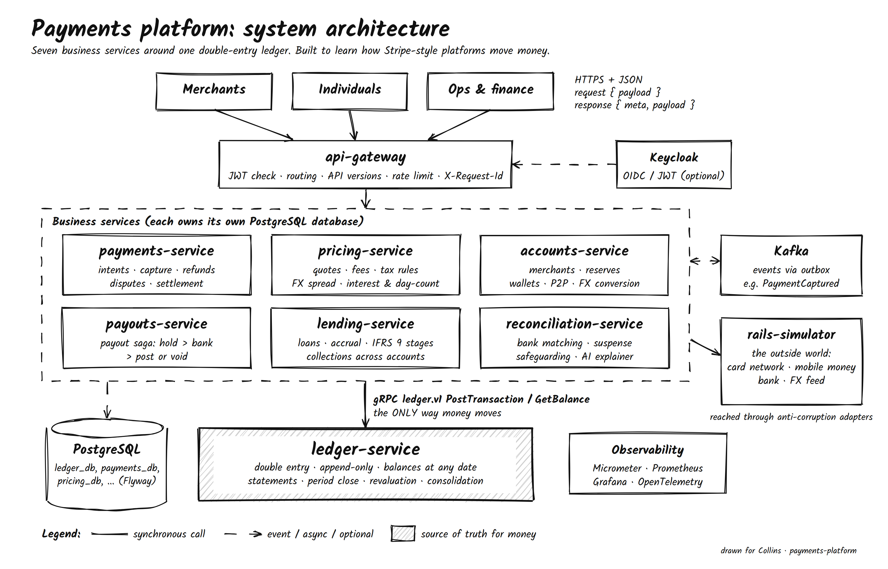

<h1 align="center">FinCore</h1>

<p align="center">
  A learning-grade, multinational payments platform built around a double-entry ledger.<br>
  Card payments, wallets, payouts, lending and reconciliation, the way Stripe-style platforms do it.
</p>

<p align="center">
  
  
  
  
  
  
</p>

<p align="center">
  
</p>

> **Not for real money.** This is a portfolio and learning project. There is no card data, no PCI scope and no real
> bank. A simulator stands in for the card network, mobile money, the bank and FX feeds.

## Contents

- [Why this project](#why-this-project)
- [What it does](#what-it-does)
- [Architecture](#architecture)
- [API conventions](#api-conventions)
- [Quick start (Docker Compose)](#quick-start-docker-compose)
- [Run it from IntelliJ](#run-it-from-intellij)
- [Tests](#tests)
- [Deploy to your Kubernetes cluster](#deploy-to-your-kubernetes-cluster)
- [Project structure](#project-structure)
- [Configuration](#configuration)
- [Known limitations](#known-limitations)
- [Documentation](#documentation)

## Why this project

Money systems have one rule that everything else serves: **money is never created or lost; it only moves between
accounts, and every movement balances.** This project builds that rule into a real system and then layers
everything a payment company needs on top of it:

- a **double-entry ledger** that is the only place balances change,
- **payments**, **wallets**, **payouts**, **lending** and **collections**, each posting balanced journal entries,
- **fees, taxes and FX** priced by quotes, with tax rules stored as versioned data per country,
- **reconciliation**, **period close**, **financial statements** and **multi-entity consolidation**.

The accounting behind every feature is explained from zero in the
**[accounting guide](docs/accounting/ACCOUNTING_GUIDE.md)**.

## What it does

| Service | Port | What it owns |
|---|---|---|
| `ledger-service` | 8081 (REST), 9091 (gRPC) | Legal entities, chart of accounts, journal, balances, statements, trial balance, balance sheet, income statement, period close, FX revaluation, consolidation |
| `pricing-service` | 8082 | Quotes: fees, VAT/GST/excise by jurisdiction (versioned rules), FX rates with spread, interest and day-count, amortization schedules |
| `payments-service` | 8083 | Payment intents: authorize, capture, cancel, refunds, chargebacks, network settlement |
| `accounts-service` | 8084 | Merchants (rolling reserves) and individuals (several wallets each, top-ups, P2P, FX conversion, paying merchants) |
| `payouts-service` | 8085 | All money out: merchant payouts and wallet withdrawals as a saga (hold, bank, post or void) |
| `lending-service` | 8086 | Merchant financing repaid from sales, instalment loans, daily interest, delinquency, IFRS 9 stages, write-offs, collections across accounts |
| `reconciliation-service` | 8087 | Bank statement matching, suspense, safeguarding check, optional Spring AI mismatch explainer |
| `rails-simulator` | 8089 | Fake card network, mobile money, bank and FX feed with failure modes |
| `api-gateway` | 8080 | Single entry point: routing, optional JWT (Keycloak), API versions, rate limiting, request ids |

Every flow, with its journal entries, is described in the [accounting guide](docs/accounting/ACCOUNTING_GUIDE.md).

## Architecture

- **Microservices by bounded context**: 9 bounded contexts deployed as 7 business services. Merchants and wallets
  share `accounts-service`; loans and collections share `lending-service`, as modules with their own schemas.
- **Ledger as the single writer of balances.** Every service posts through the `ledger.v1` **gRPC** contract
  (`ledger-api` module). Everything else is REST.
- **Hexagonal inside each service**: domain rules (`JournalRules`, `PricingRules`, `InterestMath`, `LoanRules`) are pure
  Java with unit tests; JDBC, HTTP, gRPC and Kafka are adapters.
- **JdbcTemplate, no ORM**: the SQL is the design. Each service owns its database and its Flyway migrations.
- **Transactional outbox + idempotent consumers** for Kafka events.
- **Sagas, not distributed transactions**: payouts, loan disbursement and recoveries compensate step by step.
- **Stripe-style API edge**: idempotency keys, intent objects with state machines, date-based API versions.

Editable diagram: [`docs/architecture/system-architecture.drawio`](docs/architecture/system-architecture.drawio)
(open it in [draw.io](https://app.diagrams.net); it uses draw.io's sketch style). The full design is in the
**solution architecture document**: [`docs/Solution-Architecture.docx`](docs/Solution-Architecture.docx). Decisions are
recorded as [ADRs](docs/adr).

## API conventions

Every request body has the business data under `payload`:

```json
{ "payload": { "merchantId": "mer_9f3k2m1x8z4q7t", "amountMinor": 100000, "currency": "KES", "method": "CARD" } }
```

Every response has `meta` and `payload`:

```json
{
  "meta": { "requestId": "7c1e…", "timestamp": "2026-10-01T09:00:00Z", "status": "SUCCESS", "path": "/v1/payment-intents", "errors": [] },
  "payload": { "id": "pi_4n8x2k…", "status": "AUTHORIZED", "amountMinor": 100000, "currency": "KES" }
}
```

Errors use the same shape with `"status": "ERROR"` and a stable code:

```json
{ "meta": { "status": "ERROR", "errors": [ { "code": "INSUFFICIENT_FUNDS", "message": "Account 2010:wal_… (KES) does not have enough funds" } ] }, "payload": null }
```

- **Money** is always an integer in minor units (`100000` = 1,000.00 KES), never a float.
- **Idempotency**: every POST that moves money needs an `Idempotency-Key` header. A retry with the same key and body
  returns the first result; the same key with a different body is rejected.
- **Correlation**: send `X-Request-Id` (or get one); it appears in every service's logs.
- **Versions**: `Platform-Version: 2026-10-01` (the gateway adds the default).

## Quick start (Docker Compose)

Needs Docker (with Compose) and, for the smoke test, `curl` and `jq`.

```bash
docker compose up --build          # first build takes a few minutes
./scripts/e2e-smoke.sh             # runs every money flow and checks the books balance after each
```

A first payment, by hand:

```bash
GW=http://localhost:8080
MER=$(curl -s -X POST $GW/v1/merchants -H 'Content-Type: application/json' \
  -d '{"payload":{"entityId":"KE","name":"Duka","country":"KE","settlementCurrency":"KES","reservePercentBp":0,"reserveDays":0}}' \
  | jq -r .payload.merchantId)

PI=$(curl -s -X POST $GW/v1/payment-intents -H 'Content-Type: application/json' -H "Idempotency-Key: $(uuidgen)" \
  -d "{\"payload\":{\"merchantId\":\"$MER\",\"amountMinor\":100000,\"currency\":\"KES\",\"method\":\"CARD\"}}" \
  | jq -r .payload.id)

curl -s -X POST $GW/v1/payment-intents/$PI/capture -H 'Content-Type: application/json' -d '{"payload":{}}' | jq .payload
curl -s "$GW/v1/entities/KE/reports/trial-balance" | jq .payload.totals
```

## Run it from IntelliJ

1. **File → Open** the repository root and import it as a Maven project (Java 21).
2. Start only the infrastructure: `docker compose up postgres kafka rails-simulator`.
3. Run **Maven → fincore → Lifecycle → install** once. This generates the gRPC classes in `ledger-api`.
4. Run the `*Application` classes. Start `LedgerApplication` and `PricingApplication` first, then `AccountsApplication`
   and the others. Defaults point at `localhost`, so no configuration is needed.

## Tests

```bash
mvn verify                         # unit tests: journal rules, money, pricing, interest, lending rules
./scripts/e2e-smoke.sh             # end-to-end through the gateway, checking the trial balance after every scenario
```

The E2E script covers card capture with VAT, settlement, refunds, wallets with excise, FX conversion, payouts
(including a failing bank account), instalment loans, merchant financing withheld from sales, a missed instalment with
recovery from savings, bank reconciliation, safeguarding and the financial statements.
CI (`.github/workflows/ci.yml`) runs both.

## Deploy to your Kubernetes cluster

```bash
# 1. Build and push images to a registry your cluster can pull from
REGISTRY=registry.example.com:5000 TAG=0.1.0 PUSH=1 ./scripts/build-images.sh

# 2. Change the database password in deploy/k8s/01-config.yaml (or create the secret yourself)

# 3. Deploy: namespace, config, Postgres, Kafka, migration Jobs, services, ingress, autoscaling
REGISTRY=registry.example.com:5000 TAG=0.1.0 ./scripts/deploy-k8s.sh

# 4. Reach the gateway
kubectl -n fincore port-forward svc/api-gateway 8080:8080
```

Notes:

- Database migrations run as Kubernetes **Jobs** (`<service>-migrate`) before the apps; the apps start with Flyway off.
- Postgres and Kafka are single-node StatefulSets, which is fine for learning. Use a managed database or an operator
  (CloudNativePG, Strimzi) for anything real.
- Set `ingressClassName` and the host in `deploy/k8s/40-ingress.yaml` to match your cluster.
- Autoscaling (`41-autoscaling.yaml`) needs `metrics-server`.

## Project structure

```
fincore/
├── commons/                  shared: {payload}/{meta,payload} envelope, errors, Money, idempotency, outbox, REST clients
├── ledger-api/               ledger.v1 .proto contract + Java client (Posting builder)
├── ledger-service/           double-entry ledger, reports, close, revaluation, consolidation
├── pricing-service/          quotes, fees, tax rules, FX, interest
├── payments-service/         payment intents, refunds, disputes, settlement
├── accounts-service/         merchants + wallets modules
├── payouts-service/          payout saga
├── lending-service/          loans + collections modules
├── reconciliation-service/   matching, suspense, safeguarding, Spring AI explainer
├── rails-simulator/          the outside world, with failure modes
├── api-gateway/              Spring Cloud Gateway
├── deploy/
│   ├── docker/               Postgres init script for Compose
│   └── k8s/                  Kubernetes manifests + kustomization
├── docs/
│   ├── accounting/           ACCOUNTING_GUIDE.md
│   ├── architecture/         system-architecture.drawio / .png / .svg
│   ├── adr/                  architecture decision records
│   └── Solution-Architecture.docx
├── scripts/                  build-images.sh, deploy-k8s.sh, e2e-smoke.sh
└── docker-compose.yml
```

Each service follows the same layout: `domain` (pure rules), `application` (use cases), `infrastructure`
(JdbcTemplate repositories, adapters), `api` (controllers), and `db/migration` (Flyway).

## Configuration

| Variable | Used by | Default |
|---|---|---|
| `DB_URL`, `DB_USER`, `DB_PASSWORD` | services with a database | `jdbc:postgresql://localhost:5432/<service>_db`, `platform` |
| `FLYWAY_ENABLED` | services with a database | `true` (Kubernetes sets `false` and uses Jobs) |
| `KAFKA_BOOTSTRAP` | all services | `localhost:9092` |
| `LEDGER_GRPC_TARGET` | payments, accounts, payouts, lending | `localhost:9091` |
| `PRICING_URL`, `ACCOUNTS_URL`, `SIMULATOR_URL`, `LEDGER_URL` | callers | `http://localhost:<port>` |
| `GATEWAY_SECURITY_ENABLED`, `JWT_ISSUER_URI` | api-gateway | `false` |
| `AI_CHAT_MODEL_PROVIDER`, `OPENAI_API_KEY`, `OPENAI_MODEL` | reconciliation-service | `none` (rule-based explanations) |
| `QUOTE_TTL_SECONDS` | pricing-service | `120` |
| `LENDING_DAILY_CRON` | lending-service | `0 30 1 * * *` |

## Known limitations

Honest list, so nobody mistakes this for production software:

- Built without network access to Maven Central in the authoring environment. Every Java file was parse-checked and
  the domain maths unit-tested, but run `mvn verify` once and fix anything your toolchain reports.
- A payment's currency must equal the merchant's settlement currency; convert through a wallet otherwise.
- Transfers between legal entities are not supported yet; intercompany is modelled in the ledger and consolidation.
- Scheduled jobs (lending day, payout retries, reserve release) assume one replica; add ShedLock before scaling out.
- The gateway's rate limiter is in-memory per pod; a shared limiter (Redis) would replace it.
- Tax rules: Kenya rows follow published 2026 rules; others are clearly marked examples. Not tax advice.
- Single-node Postgres and Kafka in Kubernetes.

## Documentation

- [Accounting guide](docs/accounting/ACCOUNTING_GUIDE.md): every accounting concept in the project, from zero, with sources
- [Solution architecture document](docs/Solution-Architecture.docx)
- [System architecture diagram (draw.io)](docs/architecture/system-architecture.drawio)
- [Architecture decision records](docs/adr)

## License

MIT. See [LICENSE](LICENSE).
